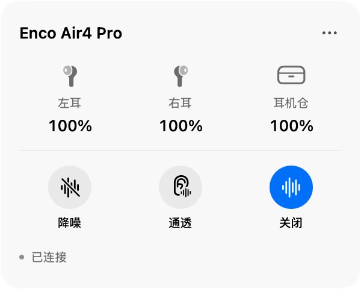

# EncoBar

[简体中文](README.md) | [English](README.en.md)

EncoBar is a macOS menu bar app for checking the battery levels of OPPO Enco Air4 Pro earbuds and switching between noise cancellation, transparency, and off modes.

## Install

1. Open the [Releases page](https://github.com/ruoshui6662/encoair4pro-bar/releases/latest).
2. Download `EncoBar-0.3.3-macos-arm64.pkg`. Quit any older version, double-click the installer, and enter your administrator password when prompted. The app installs in the standard Applications folder (`/Applications`). When upgrading, a recognized older copy in the current user's personal Applications folder is moved to the Trash; saved battery readings are kept.
3. Connect your earbuds in **System Settings → Bluetooth**, then open EncoBar from Applications.
4. Allow Bluetooth access when prompted on first launch.

Requires an Apple silicon Mac running macOS 13 or later. The installer has not been notarized by Apple. On first installation or launch, macOS may say the developer cannot be verified or the app cannot be checked for malicious software. This is a Gatekeeper warning; the installer has not been verified by Apple.

### If macOS blocks installation or launch

1. Click **Done** or **OK** in the warning. Do not move the installer to the Trash.
2. Open **System Settings → Privacy & Security** and scroll down to **Security**.
3. Find the message about the EncoBar installer, click **Open Anyway**, and confirm when prompted.
4. Open `EncoBar-0.3.3-macos-arm64.pkg` again to install. If macOS also blocks the installed app, try opening EncoBar once, return to Privacy & Security, and click **Open Anyway** for EncoBar.

Only follow these steps for EncoBar files downloaded from this project's [Releases](https://github.com/ruoshui6662/encoair4pro-bar/releases/latest), with the expected filename. Do not disable your Mac's overall security protection. See [Apple's guide](https://support.apple.com/en-us/102445) for more information.

## Use

Click the earbud icon in the menu bar to view the left earbud, right earbud, and charging case battery levels. Select **降噪** (noise cancellation), **通透** (transparency), or **关闭** (off) to change modes. **未连接** means the earbuds are disconnected.

To read the charging case battery, you usually need to place both earbuds in the case and leave the lid open. With the lid closed, the app may show the last known reading.

## Uninstall

Click **…** in the top-right corner of the panel, then **卸载 EncoBar…** (Uninstall EncoBar). Confirm and enter your administrator password when prompted. The uninstaller clears the current user's EncoBar data, Bluetooth permission, and installation receipts, and moves the system app to the Trash. Other users' data is kept.

## Supported earbuds

Only **OPPO Enco Air4 Pro** (product ID `067C10`) has been implemented and tested on real hardware. Other models are not currently supported.

Developers may be able to add OPPO Enco, OnePlus Buds, or realme Buds models that use the HeyMelody Bluetooth control protocol. Similar product names do not guarantee the same protocol. Each model needs its Bluetooth product ID, command format, and battery fields checked, followed by real-device testing before it can be listed as supported.

## References and acknowledgments

Thanks to the authors and contributors of these projects for sharing protocol documentation and implementation experience that informed EncoBar's development:

- [OppoPods](https://github.com/Leaf-lsgtky/OppoPods): HeyMelody Bluetooth protocol notes and device model data, used to understand protocol fields and identify Air4 Pro.
- [QuickBuds](https://github.com/spizganed/QuickBuds): Bluetooth control protocol documentation, used as a reference for battery queries and noise control.
- [cracked-oneplus-buds](https://github.com/AasheeshLikePanner/cracked-oneplus-buds): implementation ideas for controlling earbuds on macOS.
- [open-oneplus-buds](https://github.com/vedanth-jadhav/open-oneplus-buds): implementation ideas for a macOS menu bar earbud controller.

EncoBar uses macOS system frameworks and currently has no third-party runtime dependencies. See [source references](NOTICE.md) for specific links and the [protocol and adaptation notes](docs/protocol.md) for Air4 Pro hardware findings. These documents are currently in Chinese.

## Development and license

EncoBar is released under the [MIT License](LICENSE), allowing use and modification while retaining the required copyright and license notices. Build instructions are in the [development guide](docs/development.md) (Chinese).

This is an independent community project and is not affiliated with OPPO, OnePlus, realme, or HeyMelody.
