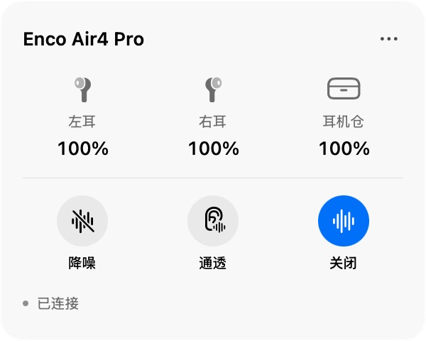

# EncoBar

EncoBar 是一款 macOS 菜单栏小工具，用来查看 OPPO Enco Air4 Pro 的电量，并切换降噪、通透和关闭模式。

## 安装

1. 打开 [Releases 下载页](https://github.com/ruoshui6662/encoair4pro-bar/releases/latest)。
2. 下载 `EncoBar-0.3.2-macos-arm64.pkg`，双击后按提示安装。
3. 在 Mac 的“系统设置 → 蓝牙”中连接耳机，然后打开“应用程序”里的 EncoBar。
4. 首次打开时，允许 EncoBar 使用蓝牙。

需要 Apple 芯片的 Mac 和 macOS 13 或更新版本。安装包尚未经过 Apple 公证，首次安装或打开时 macOS 可能提示“无法验证开发者”或“无法检查是否包含恶意软件”。这是 Gatekeeper 的安全提示，不代表安装包已通过 Apple 验证。

### 提示无法安装或打开时

1. 在提示窗口点“完成”或“好”，不要把安装包移到废纸篓。
2. 打开 Mac 的“系统设置 → 隐私与安全性”，向下滚动到“安全性”区域。
3. 找到关于 EncoBar 安装包的提示，点“仍要打开”，并按提示确认。
4. 重新双击 `EncoBar-0.3.2-macos-arm64.pkg` 安装。如果安装后首次打开 EncoBar 仍被拦截，先尝试打开一次，再回到“隐私与安全性”点 EncoBar 旁边的“仍要打开”，然后确认打开。

只对从本项目 [Releases](https://github.com/ruoshui6662/encoair4pro-bar/releases/latest) 下载且文件名匹配的 EncoBar 操作。不要为此关闭 Mac 的整体安全保护。更多说明见 [Apple 官方帮助](https://support.apple.com/zh-cn/102445)。

## 使用

点击菜单栏里的耳机图标，即可查看左右耳和耳机仓电量，并点击“降噪”“通透”或“关闭”切换模式。耳机未连接时会显示“未连接”。耳机仓电量通常要把双耳放回盒内并打开盒盖后才能读取；合盖后可能显示上次读数。

## 删除

点击面板右上角“…”→“卸载 EncoBar…”，再确认卸载。卸载工具会删除 EncoBar 自己保存的数据和蓝牙授权，并将应用移到废纸篓。

## 支持的耳机

目前仅在 **OPPO Enco Air4 Pro**（产品 ID `067C10`）上完成适配和实机验证。其他型号暂不支持。

后续二次开发可尝试使用 HeyMelody 蓝牙控制协议的 OPPO Enco、OnePlus Buds 或 realme Buds 型号。产品名称相近不代表协议相同；每个型号都需要确认蓝牙产品 ID、命令格式和电量字段，并用实机验证后才能列为支持。

## 开发与许可

本项目采用 [MIT 许可证](LICENSE)，允许使用和修改并保留署名。构建说明见[开发文档](docs/development.md)。本项目为独立社区工具，与 OPPO、OnePlus、realme 或 HeyMelody 无隶属关系。
docs/images/panel.png: PNG image data, 600 x 480, 8-bit/color RGB, non-interlaced